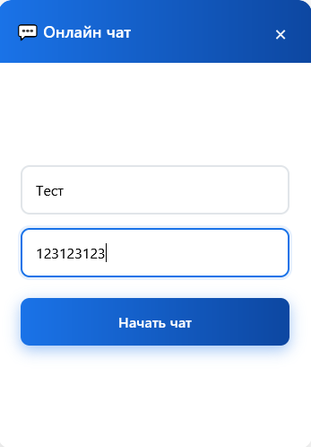
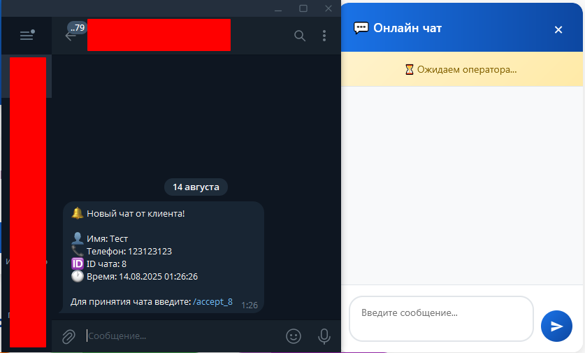
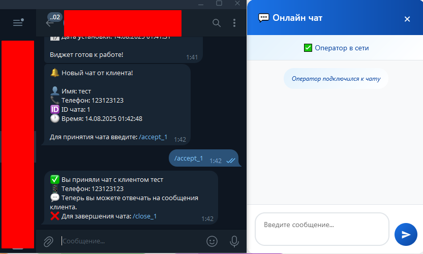
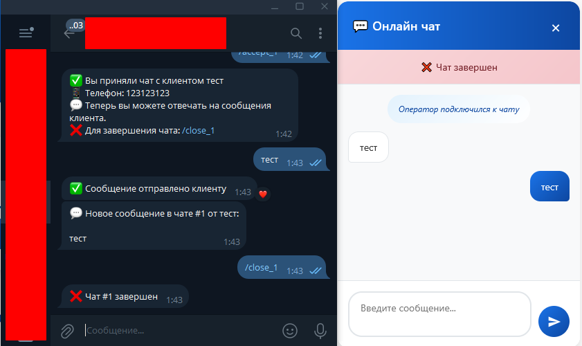

** Moved ** development continues at https://git.shd.company/bubblegum/telegram-php-widget. This GitHub copy is archived.

# 💬 Telegram PHP Widget  

   

**Бесплатный виджет чата с Telegram для вашего сайта**  
Лёгкий, быстрый и полностью открытый проект, который позволит интегрировать чат с посетителями вашего сайта через Telegram. Работает на PHP и Telegram Bot API, поддерживает SQLite для хранения данных и легко устанавливается на любой хостинг.

---

## 🚀 Возможности

✅ Полностью **бесплатен** для использования и модификации  
✅ Не требует сторонних сервисов — всё работает через ваш Telegram бот  
✅ Уведомления администратору о новых чатах прямо в Telegram  
✅ Красивый и адаптивный виджет на сайте  
✅ Поддержка управления чатом через команды бота (`/accept`, `/close`)  
✅ Простая установка и настройка за 5 минут  

---

## 📂 Структура проекта

| Директория | Назначение                          |
| ---------- |:-----------------------------------:|
| /api       | Обработка AJAX-запросов виджета     |
| /install   | Мастер начальной установки          |
| widget.js  | Основной код виджета на JavaScript  |

---

## 🛠 Установка и запуск

### 1. Загрузка на хостинг
1. Скопируйте все файлы проекта в директорию `/widget` в корне вашего сайта
2. **Важно:** убедитесь, что у вас PHP 7.4+ и HTTPS-домен

### 2. Запуск мастера настройки
1. В браузере откройте:
https://ваш-домен/widget/install/setup.php

2. Следуйте пошаговым инструкциям на экране — мастер самостоятельно настроит конфигурацию

---

## 📸 Скриншоты

| Виджет |  Виджет + Telegram | Виджет + Telegram | Виджет + Telegram |
|-----------------|------------------------|-------------------|-----------------|
|  |  |  |  |

---

## 🔒 Безопасность
- Работайте только по HTTPS
- Используйте надёжный токен Telegram бота
- Ограничьте доступ к `setup.php` после установки (можно удалить файл или закрыть .htaccess)
- Проверяйте и обновляйте зависимости при необходимости

---

## 💡 Советы
- Для тестовой установки можно использовать **бесплатный хостинг** с поддержкой PHP 7.4+ и HTTPS

---

## 📜 Лицензия

Этот проект распространяется под лицензией **GNU GPLv3** (GNU General Public License, version 3).  
Вы можете свободно использовать, изменять и распространять данный проект, **но** любые производные работы (модифицированные версии) также должны распространяться **под GPLv3**.  

📖 Ознакомьтесь с полным текстом лицензии: [GNU GPLv3](https://www.gnu.org/licenses/gpl-3.0.html)

---

## 🤝 Поддержка и развитие
Этот проект **полностью открыт и бесплатен**.  
Присоединяйтесь:
- Делайте `Fork` и предлагайте улучшения (`Pull Request`)
- Открывайте задачи (`Issue`) для багов и пожеланий
- Дорабатывайте под свои проекты — без ограничений

---

💬 **Начните общаться с клиентами через Telegram прямо сейчас — бесплатно, легко и безопасно!**
